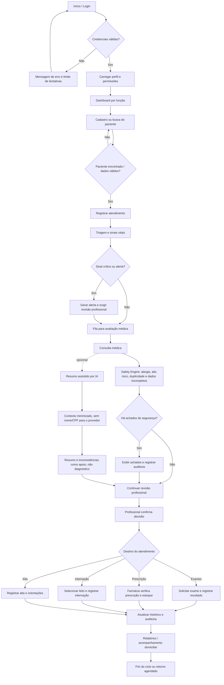

# Fluxograma do Sentinela

Este fluxo descreve o comportamento esperado da aplicação demonstrativa. As setas de decisão representam validações; nenhum resultado da IA substitui a decisão do profissional.

## Avaliação do fluxo

- **Ordem geral:** cadastro/identificação → triagem → consulta → checagem de segurança → decisão clínica → exames, prescrição, internação ou alta.
- **Ponto obrigatório:** o Safety Engine deve rodar no backend, não apenas na tela, e seus achados precisam ser apresentados antes da conclusão do fluxo.
- **Auditoria:** registrar alterações e ações sensíveis, sem gravar senhas, tokens ou prontuários completos nos logs técnicos.
- **IA:** é uma etapa auxiliar e não um gate clínico. O fluxo principal precisa continuar disponível quando a chave externa estiver ausente ou a IA falhar.
- **Limitação atual:** este diagrama descreve o fluxo-alvo e a navegação documentada. A cobertura integral de cada ramificação precisa ser confirmada por testes de integração no ambiente implantado.
